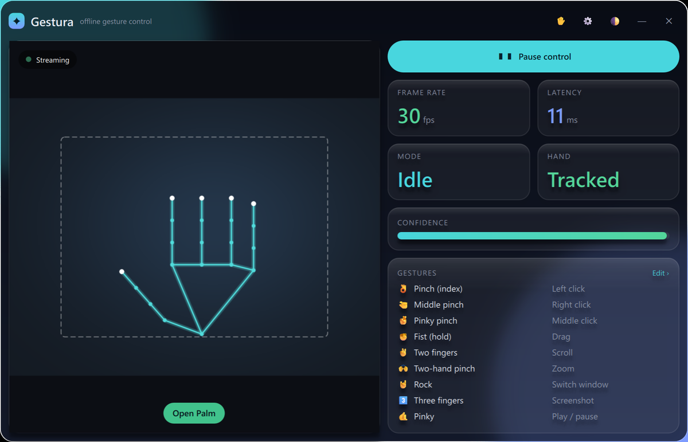
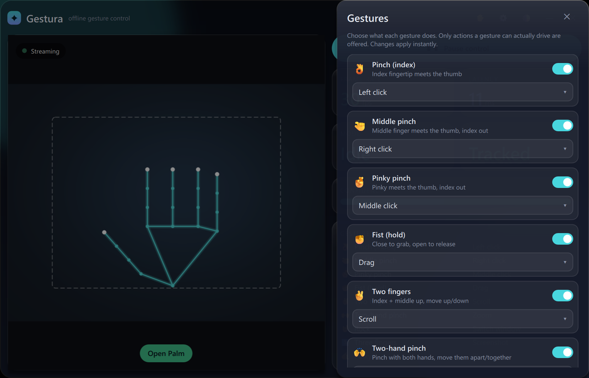
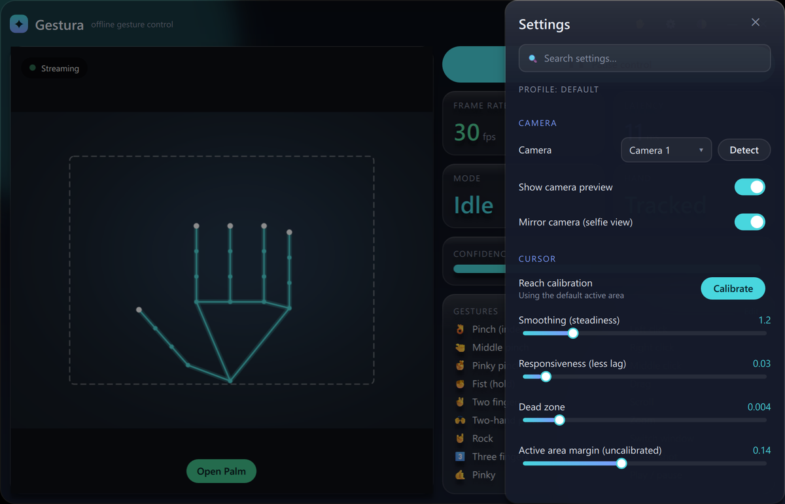

<div align="center">

# Gestura

**Control your computer with your hands — fully offline, privacy-first.**

[](https://github.com/NextGenDev-KSK/gestura/actions/workflows/ci.yml)
[](LICENSE)


Gestura turns any webcam into a low-latency gesture controller: move the cursor, click,
drag, scroll, zoom, adjust volume and brightness, control media, switch windows, fire keyboard
shortcuts, and teach it your own gestures — all processed locally on your machine. No cloud, no
account, no telemetry.

</div>



<sub>Main window. The camera area here shows a sample hand pose on a plain background, not a real
camera feed.</sub>

| Gesture editor | Settings |
|:---:|:---:|
|  |  |

---

## Why Gestura

- **Offline by default.** Every frame is processed on-device with Google MediaPipe. Nothing
  leaves your computer — Gestura makes no network connections at runtime.
- **Fast.** CPU-first pipeline targeting **60 FPS** capture and **< 20 ms** gesture-to-action
  latency, with an optional GPU delegate.
- **Trustworthy.** Aggressive false-positive prevention: temporal smoothing, confidence gating,
  hysteresis, per-gesture cooldowns, and tracking-loss recovery so the cursor never "jumps" or
  misclicks.
- **Yours.** Rebind any gesture, record your own, and map gestures to key chords — all from the
  app, no config files or code.
- **Native.** A Qt 6 / QML interface with glassmorphism, live camera preview with hand-skeleton
  overlay, FPS/latency/confidence HUD, an always-on-top status overlay, and light/dark themes.

## Features

| Area | What you get |
|------|--------------|
| Pointer | Cursor follows your knuckles (so pinching never nudges it), One-Euro smoothing, dead zone, adjustable active area |
| Mouse | Left / right / middle click (three distinct pinches), double-click, fist-hold drag, two-finger scroll, **two-hand pinch-to-zoom** |
| System | Volume, brightness, screenshot, media play/pause/next/previous, window switch/minimise/maximise/snap/close, show desktop |
| Shortcuts | Bind any gesture to **any key chord** (e.g. `ctrl+shift+s`, `alt+f4`, `win+d`) |
| Gesture editor | Rebind, enable/disable, or unbind every gesture in-app. Only actions a gesture can actually drive are offered, so a binding can't silently do nothing |
| Gesture trainer | Name a hand shape, press **Record**, hold it for ~1 s — Gestura learns it from 40 frames on-device, ready to bind |
| Reliability | Stability gates, cooldowns, exclusive drag/scroll/zoom modes, clean release on tracking loss, automatic camera reconnection |
| Background app | Runs from the **system tray** (closing the window keeps it on), **Ctrl+Alt+G** pauses/resumes from anywhere, optional **start with Windows**, single instance |
| Reach calibration | Sweep your hand once and the cursor maps exactly your comfortable reach onto the whole screen; the preview shows that area |
| Camera | Pick between webcams live, mirror toggle, and a preview on/off switch (gesture control keeps running) |
| Settings | Live, searchable settings panel; typed, validated, atomically-saved config with automatic schema migration |

The full gesture vocabulary and usage tips are in the [user guide](docs/USER_GUIDE.md).

## Technologies

- **Python 3.10 – 3.12**
- **MediaPipe** Hand Landmarker (21-point hand tracking, offline) + **OpenCV** (camera capture)
- **NumPy** (feature extraction, nearest-prototype custom-gesture classifier)
- **PySide6 / Qt 6 Quick (QML)** — UI
- **Pydantic v2** — typed, validated settings
- **Win32 `SendInput`** via `ctypes` (input injection), **pycaw** (volume),
  **screen-brightness-control** (brightness), **Pillow** (screenshots)
- **pytest**, **Ruff**, **mypy**; **PyInstaller** + **Inno Setup** for the Windows build;
  GitHub Actions CI

Every dependency is justified in [`docs/DECISIONS.md`](docs/DECISIONS.md).

## Status

**Alpha (v0.2)** — the full pipeline, every gesture above, the in-app gesture editor and trainer,
system-tray operation, reach calibration,
and the Windows integration are implemented and covered by an automated test suite that runs
without a camera. A Linux port is an architectural goal (the OS layer is a single interface) but
not yet implemented.

## Download

Get the latest version from the **[Releases page](https://github.com/NextGenDev-KSK/gestura/releases/latest)**:

- **`GesturaSetup-<version>.exe`** (recommended): installs for your Windows account, no admin
  rights needed. Adds a Start-menu entry and an uninstaller.
- **`Gestura-<version>-windows-x64-portable.zip`**: no installation; extract anywhere and run
  `Gestura\Gestura.exe`.

Windows may show *"Windows protected your PC"* the first time, because the app isn't code-signed yet. Click **More info → Run anyway**. Each release lists SHA-256 checksums so you can verify your download.

## Requirements

- Windows 10 or 11
- Python 3.10 – 3.12 (to run from source)
- A webcam

## Quick start (from source)

```powershell
git clone https://github.com/NextGenDev-KSK/gestura
cd gestura
python -m venv .venv
.\.venv\Scripts\Activate.ps1
pip install -e ".[dev]"
python scripts\fetch_models.py      # downloads the MediaPipe hand-landmark model (~7.8 MB)
gestura                             # launch the app
```

Useful variants:

```powershell
python -m gestura --dry-run              # full app, but injects no real input (safe demo)
python -m gestura --self-test 2          # load the UI, verify it, exit (no camera needed)
python -m gestura.engine.pipeline --demo # headless: camera -> tracking -> gestures, in the console
python scripts\diagnose.py               # camera + tracker health and performance report
```

## Configuration

No API keys, accounts or environment variables are needed. Everything is configured in the app
(⚙ **Settings** and ✋ **Gestures**) and stored per user:

| What | Where |
|------|-------|
| Settings (tuning, bindings, theme) | `%APPDATA%\Gestura\settings.json` |
| Recorded custom gestures | `%LOCALAPPDATA%\Gestura\custom_gestures.json` |
| Screenshots | `%LOCALAPPDATA%\Gestura\screenshots\` |
| Logs | `%LOCALAPPDATA%\Gestura\logs\gestura.log` |

A corrupt settings file is backed up and replaced with defaults instead of crashing the app, and
settings written by older versions are migrated automatically (your own edits are kept).

## Testing

```powershell
pytest                              # 150+ unit tests — no camera, GPU or display required
pytest --cov=gestura                # with coverage
ruff check src tests scripts        # lint
python -m gestura --self-test 2     # the UI loads with no QML errors
```

CI runs lint, the test suite (Windows, Python 3.11 and 3.12) and the UI self-test on every push.

## Building the Windows app

```powershell
pip install -e ".[dev,packaging]"
python scripts\build_exe.py         # -> dist\Gestura\Gestura.exe
iscc packaging\gestura_installer.iss  # -> installer (requires Inno Setup)
```

See [`docs/RELEASE.md`](docs/RELEASE.md) for the full release checklist.

## Architecture at a glance

```
Presentation (Qt6/QML)  ─┐
Application (controller) ─┤   each layer depends only on the one below,
Gesture Engine           ─┤   through explicit interfaces — see ARCHITECTURE.md
AI Recognition (MediaPipe)┤
Gesture Interpreter      ─┤
Action Dispatcher        ─┤
OS Adapter (Windows)     ─┘
```

## Documentation

| Doc | Purpose |
|-----|---------|
| [`docs/USER_GUIDE.md`](docs/USER_GUIDE.md) | Installing and using the app, every gesture, troubleshooting |
| [`docs/ARCHITECTURE.md`](docs/ARCHITECTURE.md) | System design, layers, data flow |
| [`docs/DECISIONS.md`](docs/DECISIONS.md) | Architecture Decision Records (why each library) |
| [`docs/PERFORMANCE.md`](docs/PERFORMANCE.md) | Frame-rate and latency notes |
| [`docs/DEVELOPER_GUIDE.md`](docs/DEVELOPER_GUIDE.md) | Building, testing, extending |
| [`docs/RELEASE.md`](docs/RELEASE.md) | Release checklist |
| [`CHANGELOG.md`](CHANGELOG.md) | What changed in each version |
| [`CONTRIBUTING.md`](CONTRIBUTING.md) | How to contribute |

## License

Apache License 2.0 — see [`LICENSE`](LICENSE). Copyright © 2026 Krithik S.
